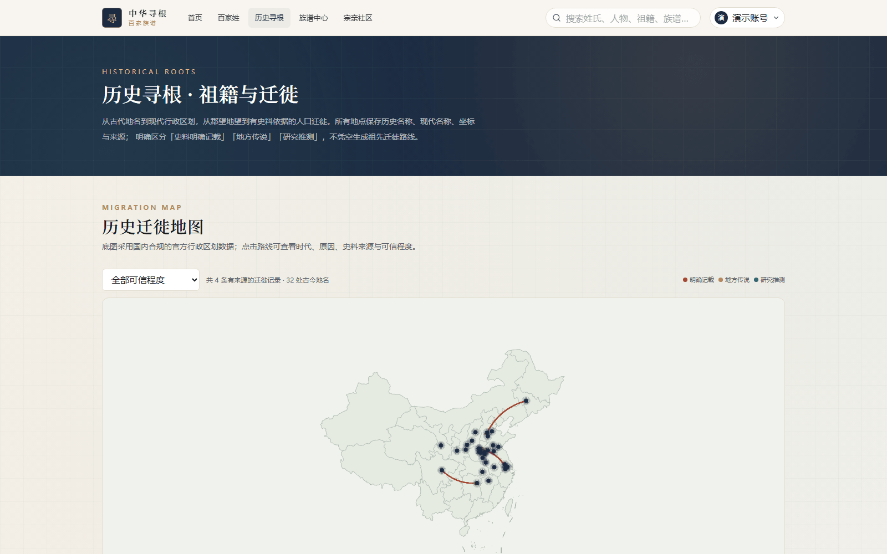
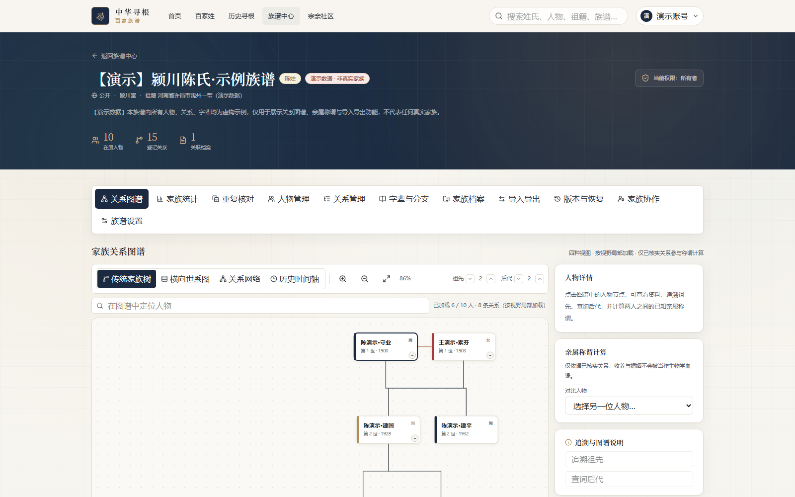
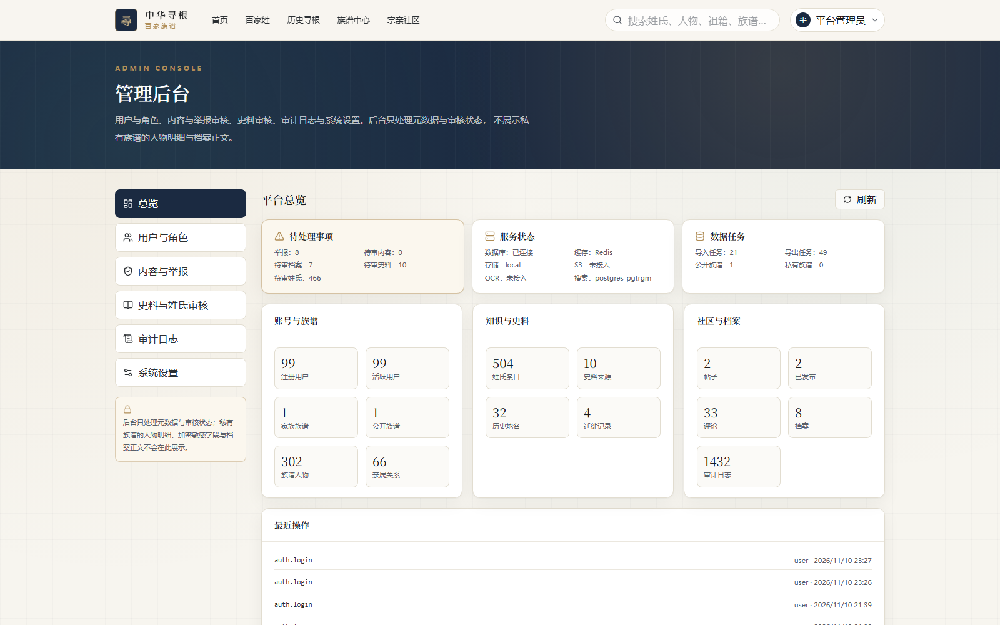
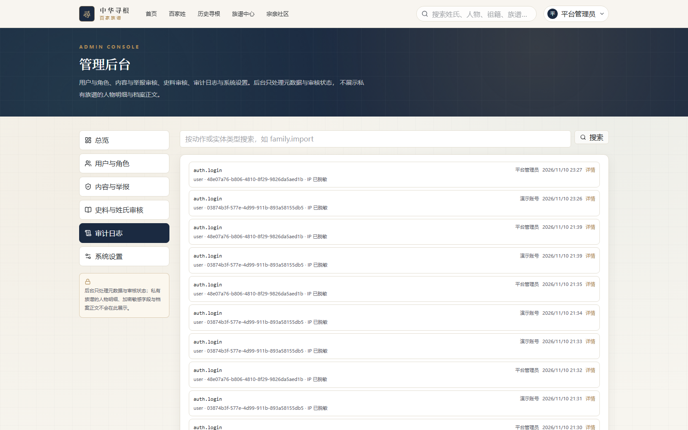
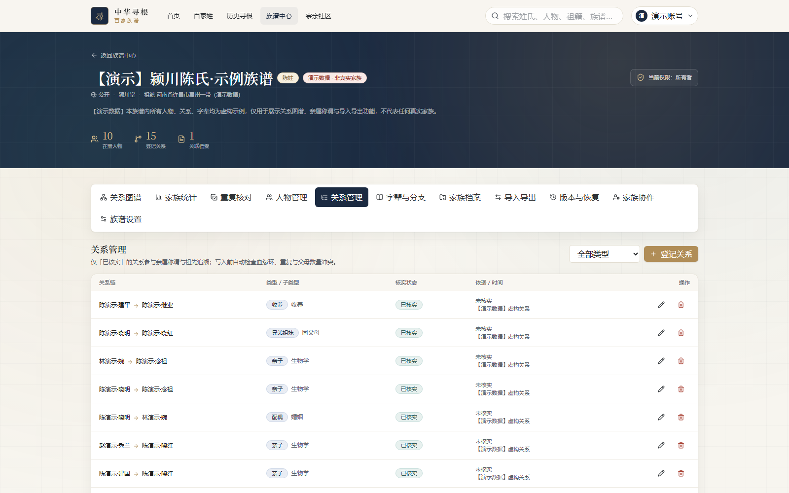
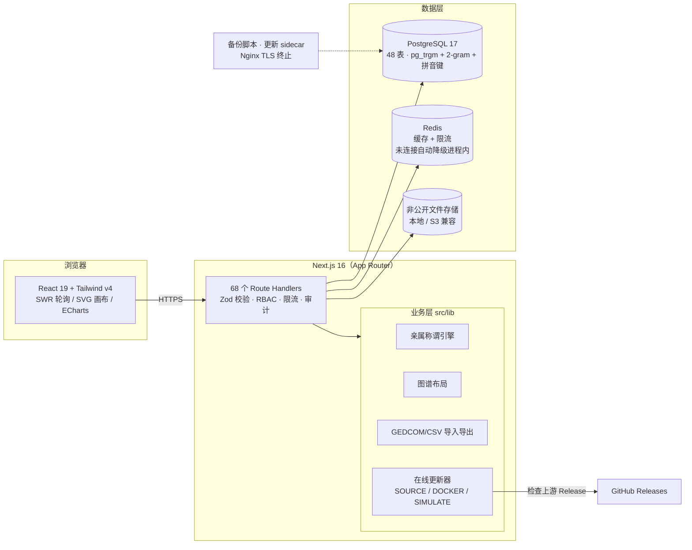

<div align="center">


# 中华寻根 · 百家族谱

**Chinese Genealogy & Heritage Platform**

寻一姓之源，续一脉之谱 —— 以史料为据、以隐私为界的中华姓氏文化与家族族谱平台

[](https://github.com/yuchen0x1/Family-Genealogy-of-Hundreds-of-Clans/actions/workflows/ci.yml)
[](https://github.com/yuchen0x1/Family-Genealogy-of-Hundreds-of-Clans/releases)
[](LICENSE)
[](https://nextjs.org)
[](https://www.typescriptlang.org)
[](https://www.postgresql.org)
[](https://github.com/yuchen0x1/Family-Genealogy-of-Hundreds-of-Clans/stargazers)

**[功能总览](#-核心功能) · [快速开始](#-快速开始) · [部署运维](#-部署与运维) · [在线更新](#-部署与运维) · [文档索引](#-使用指南与文档)**

English README: [README_EN.md](README_EN.md)

</div>

---

## 📖 项目简介

**中华寻根 · 百家族谱**是一个全栈真实实现的开源平台：从中华姓氏的得姓源流、郡望堂号、祖籍迁徙，到真实家族的人物、关系、字辈、档案协作，全部落库、全部有据。

它同时是两类系统的组合：

- **姓氏文化数字档案馆** —— 收录《百家姓》通行本全表 504 姓（444 单姓 + 60 复姓），带史料引用、可信程度分级与审核状态；
- **家族族谱协作平台** —— 家族创建、人物/关系管理、四种视图的关系图谱、亲属称谓计算、字辈世代、档案文献、GEDCOM/CSV/JSON 导入导出、版本快照与恢复。

**与常见电子族谱软件的区别，在于三条数据边界：**

1. **历史姓氏资料 ≠ 用户真实家族关系**。史料库、历史人物、宏观迁徙独立建模，与用户族谱物理分表。
2. **历史人物 ≠ 用户家族成员**。同名不会触发任何自动合并或关系推导。
3. **同姓 ≠ 同宗**。宗亲关联需双方显式确认，确认后也**不**创建亲属关系，不参与称谓计算。

适合：家族修谱组织者、姓氏文化研究者、地方宗亲会、想为家族留一份可考数字档案的开发者与爱好者。

## 最新更新

**v0.2.2（2026-11-13）**：稳定版在线更新改用项目专用发布包，安装前校验包大小与 SHA-256；管理员可配置强制数字签名校验，校验缺失或失败时会拒绝安装。详见[发布记录](docs/releases/release-notes.md)。

---

## 🖼️ 产品一览

> 以下截图均来自本仓库实际运行的页面（演示数据来自 seed，页面内明确标注），未做任何手绘或合成。

| 首页 · 全站检索 | 百家姓知识库 |
| --- | --- |
|  |  |

| 姓氏详情（史料分级 + 郡望堂号） | 历史寻根 · 迁徙地图 |
| --- | --- |
|  |  |

| 关系图谱（四种视图 + 称谓计算） | 家族统计仪表盘 |
| --- | --- |
|  |  |

| 人物管理 | 字辈与分支 |
| --- | --- |
|  |  |

| 家族档案中心 | 宗亲社区 |
| --- | --- |
|  |  |

| 管理后台 | 后台 · 系统在线更新 |
| --- | --- |
|  |  |

<details>
<summary>更多界面：族谱中心 / 关系管理 / 导入导出 / 审计日志 / 个人中心 / 使用说明</summary>

| 族谱中心 | 审计日志（IP 已脱敏） |
| --- | --- |
|  |  |

| 关系管理 | 导入导出 |
| --- | --- |
|  |  |

| 个人中心 | 使用说明 |
| --- | --- |
|  |  |

</details>

---

## ✨ 核心功能

### 🔍 中华百家姓知识库


- 收录《百家姓》通行本全表 **504 姓**（444 单姓 + 60 复姓，序位 1..504，非现代人口排名）
- **38 姓含史料级条目**：得姓源流、异体字、郡望堂号、历史人物、迁徙线索与来源引用；466 姓为字典型条目（字形/读音/繁体/序位），**不编造源流**，卡片标注「源流待补录」
- 每条史料带：资料名称、作者、版本、卷次/页码、原文引用、录入人、审核状态与可信程度（`DOCUMENTED / TRADITION / INFERRED / UNVERIFIED`）
- 拼音 A–Z 检索、繁体检索、异体字归一、「资料范围」筛选

### 🗺️ 历史寻根与祖籍迁徙


- 宏观迁徙记录 + 古今地名对照（历史名称、现代名称、坐标、来源）
- 本地合规行政区划 GeoJSON 地图（含台湾省、香港/澳门特别行政区），不依赖外部地图服务
- 明确区分「史料明确记载 / 地方传说 / 研究推测」，不凭空生成祖先迁徙路线

### 🌳 家族族谱与关系图谱


- **四种视图**：传统家族树、横向世系图、关系网络（力导向）、历史时间轴，按视野局部加载（服务端节点上限 200）
- 图内定位人物、祖先/后代追溯（BFS）、两两之间**亲属称谓计算**（仅依据已核实关系；收养与婚姻不会被当作生物学血缘）
- SVG 无限画布 + ECharts，截图/导出可用

### 👥 人物与关系管理


- 人物与关系分开登记：生卒、性别、字号、别名、生平；敏感资料 AES-256-GCM 加密落库
- **搜索覆盖姓 / 名 / 字号 / 别名**（pg_trgm 索引兜底超大家族）
- 关系类型/方向/核实状态全可控，8 类冲突检测（重复关系、血缘环等）
- **疑似重复人物核对**：三档置信度列出可疑配对并给出可读判定依据，只提示、**绝不自动合并**
- 软删除回收站、人物级可见性（在世非公开人物自动隐藏生卒年）

### 📜 字辈、世代与分支


- 字辈用字与世代对应关系由家族成员依据族谱/碑文/口述明确登记，**系统不会从名字里的某个字自动认定世代**
- 字辈诗录入后默认待审核，不会自动把人物归入对应世代
- 分支创建与成员挂接，世代人口分布一图可见

### 🗂️ 家族档案中心


- 老谱扫描、照片、PDF、音视频与文本资料统一归档
- 上传校验：扩展名 + MIME + 实际文件头三重检查，计算 SHA-256 校验和并生成版本记录
- 文件写入**非公开存储目录**（本地 `.storage/uploads` 或 S3 兼容对象存储），绝不落 `public/`；下载逐次鉴权
- OCR 为外部依赖，未配置时明确报错，**不会**自动把 OCR 文本转成亲属关系

### 🔄 导入导出与版本快照


- **7 种导出真实字节**：CSV / JSON / GEDCOM 5.5.1 / GEDCOM 7.0 / SVG / PNG / PDF
- GEDCOM 导入带预览报告（不落库）→ 显式确认后事务写入；导入关系一律标记 `UNVERIFIED`
- 全家族**版本快照与恢复**（恢复需显式 `RESTORE` 确认）

### 👨‍👩‍👧 协作与宗亲社区


- 邀请链接 + 角色权限（OWNER / ADMIN / EDITOR / VIEWER），邮箱裁剪显示
- PRIVATE / FAMILY / PUBLIC 三级帖子、两级评论、举报处理、私信与通知
- 宗亲关联申请：双方确认 + 证据说明，确认后**不**创建亲属关系

### 🛠️ 管理后台与在线更新


- 用户与角色、内容与举报、史料与姓氏审核、审计日志（写入即脱敏）
- **隐私边界**：管理员只能处理元数据与审核状态，**无法查看私有族谱的人物明细、加密敏感字段与档案正文**——这是刻意设计，不是权限缺失
- **在线更新**：自托管实例从上游仓库检查新版本、查看更新日志，并在安装前校验 Release 资产大小、SHA-256 与可选数字签名后一键升级；配置细节见 [docs/AUTO_UPDATE.md](docs/AUTO_UPDATE.md)
  - 三种驱动：`SOURCE`（源码部署）/ `DOCKER`（sidecar 重建镜像）/ `SIMULATE`（演示，生产禁用）
  - 更新前强制备份（失败即中止）；发布包流式安全校验（路径穿越、校验和、体积与条目上限等）
  - 目标版本由服务端决定，前端无法指定；有新版本时后台角标 + 登录后提示条自动提醒

---

## 🔐 数据安全与隐私

这是本项目最核心的设计取向，全部为真实实现：

| 机制 | 说明 |
| --- | --- |
| 物理分表 | 历史姓氏资料与用户族谱完全分表，历史人物永不并入用户家族 |
| 默认私有 | 家族与人物默认 `PRIVATE`，公开需要显式操作 |
| 在世人物保护 | 公开族谱中在世非公开人物只展示姓名与世代，不展示生卒年；统计接口同样遵循（防止聚合反推个人生日） |
| 字段级加密 | 人物敏感资料 AES-256-GCM 加密存储，列表接口不返回密文 |
| 档案非公开存储 | 上传文件存于 `public/` 之外，静态直连不可访问，下载逐次鉴权 + 审核 |
| 权限隔离 | 家族级（OWNER/ADMIN/EDITOR/VIEWER）+ 人物级可见性双层控制 |
| 后台最小化 | 管理员只能处理元数据与状态，无法读取私有族谱内容 |
| 审计脱敏 | 审计日志写入即替换密码/令牌/私密正文并截断超长字段 |
| 输入防线 | Zod 全量校验、参数化查询、CSRF 同源校验、多维限流、上传三重伪装检测 |
| 备份恢复 | `pnpm db:backup` 数据库 + 上传文件双通道快照，恢复前强制校验目标为空、绝不覆盖 |
| 账号自主权 | 个人数据导出、账号注销（公开内容同步下线）、会话管理 |

安全实测：42 项真实 HTTP 安全审计全部通过（详见 [docs/SECURITY_AUDIT.md](docs/SECURITY_AUDIT.md)）。**不夸大**：CSP 暂含 `unsafe-inline`（Next.js/ECharts 现状取舍，已论证记录）；未经独立第三方渗透测试。

## 🏗️ 系统架构



业务请求链路：**浏览器 → Next.js Route Handlers（鉴权/校验/限流）→ 业务层 → Prisma → PostgreSQL**；文件直连非公开存储，Redis 只做缓存与限流，挂了自动降级。

## 🧰 技术栈

| 层 | 选型（版本来自 `package.json` 与实测构建） |
| --- | --- |
| 前端 | Next.js 16.4.5（App Router / Turbopack）、React 19.3.1、TypeScript 6.0.3、Tailwind CSS v4、SWR、ECharts |
| 服务端 | Next.js Route Handlers ×68、Zod、scrypt 密码哈希、AES-256-GCM 字段加密 |
| 数据库 | PostgreSQL 17、Prisma 6.19（48 model / 6 迁移）、`pg_trgm` + 中文 2-gram + 拼音检索键 |
| 缓存 | Redis（ioredis，未连接自动降级进程内缓存/限流） |
| 存储 | 本地非公开目录（默认）/ S3 兼容对象存储（需配置凭据） |
| 测试 | Vitest（20 文件 / 225 项）、5 套 HTTP 冒烟（323 项）、Playwright E2E（11 项）、安全审计 42 项、性能基线 |
| 部署 | Dockerfile、docker-compose（app + nginx + postgres + redis + updater sidecar）、Nginx TLS 终止、systemd 单元 |

## 🚀 快速开始

> **这是一个自托管的服务端应用，不是手机 App，没有 `.apk` / `.exe` 安装包。**
> 「下载最新版本」= 获取源码（或镜像）后在你自己的服务器/本机跑起来。三种方式任选其一：

| 方式 | 命令 | 适用 |
| --- | --- | --- |
| **A. Git 克隆**（推荐，便于 `git pull` 升级） | `git clone https://github.com/yuchen0x1/Family-Genealogy-of-Hundreds-of-Clans.git` | 本机开发、自有服务器 |
| **B. 下载压缩包** | 打开 [Releases](https://github.com/yuchen0x1/Family-Genealogy-of-Hundreds-of-Clans/releases/latest) → `Assets` 下的 **Source code (zip)** | 不想用 git 的场景 |
| **C. Docker 一键起** | 解压/克隆后 `docker compose up -d --build` | 有 Docker 的服务器 |

想确认拿到的是最新版：`package.json` 的 `version` 应等于 [最新 Release](https://github.com/yuchen0x1/Family-Genealogy-of-Hundreds-of-Clans/releases/latest) 的 tag 去掉 `v`（当前 `0.2.2`）。

**环境要求**：Node.js ≥ 22、pnpm 11（Corepack）。Windows / macOS / Linux 均可；Windows 优先用 PowerShell。

```powershell
# 1. 克隆并安装（PowerShell）
git clone https://github.com/yuchen0x1/Family-Genealogy-of-Hundreds-of-Clans.git
cd Family-Genealogy-of-Hundreds-of-Clans
corepack enable
Copy-Item .env.example .env      # 生产必须替换 SESSION_SECRET 与 ENCRYPTION_KEY

# 2. 启动数据库（项目内置 PostgreSQL 17 二进制，数据目录 ~/.xungen-pg）
pnpm install
pnpm db:pg

# 3. 迁移 + 初始化数据（新开一个终端）
pnpm db:migrate                  # prisma migrate deploy，共 6 个迁移
pnpm db:seed                     # 幂等写入角色、史料、姓氏、地名、迁徙与演示族谱

# 4. 启动
pnpm dev                         # http://localhost:3000
```

```bash
# macOS / Linux / Git Bash：把 Copy-Item 换成 cp，其余一致
cp .env.example .env
pnpm install && pnpm db:pg
pnpm db:migrate && pnpm db:seed
pnpm dev
```

Redis 为可选：本机有 `redis-server` 自动连接，否则降级为进程内缓存与限流。

**体验演示数据**：seed 自带公开演示族谱「【演示】颍川陈氏·示例族谱」（人物、关系、字辈均为虚构并明确标注）。演示账号仅用于本地开发：

> 普通用户账号 `demo@xungen.local`，初始口令由 `prisma/seed.ts` 写入，**仅用于本地开发体验**。
> 管理员账号由 `.env` 的 `SEED_ADMIN_EMAIL` / `SEED_ADMIN_PASSWORD` 创建，
> **生产部署后必须立即改密或禁用**（步骤见 [docs/DEPLOYMENT.md](docs/DEPLOYMENT.md) 第 9 节）。
> 本文档不公开任何可用口令——请在本机 `.env` 或 seed 脚本中查看。

**Docker 部署**（app + nginx + postgres + redis + 更新 sidecar）：

```bash
docker compose up -d --build
# 首次部署的完整验收步骤见 docs/DEPLOYMENT.md
```

## 📚 使用指南与文档

| 文档 | 内容 |
| --- | --- |
| [docs/USER_GUIDE.md](docs/USER_GUIDE.md) | 用户操作说明（建谱、人物、关系、档案、社区） |
| [docs/API.md](docs/API.md) | 全部 API、权限模型与错误码 |
| [docs/DEPLOYMENT.md](docs/DEPLOYMENT.md) | 部署、HTTPS、备份恢复、升级与在线更新排障 |
| [docs/TEST_REPORT.md](docs/TEST_REPORT.md) | 2026-11-10 发布轮实测：601 项自动化断言全绿 |
| [docs/SECURITY_AUDIT.md](docs/SECURITY_AUDIT.md) | 安全设计、42 项审计结果与遗留项论证 |
| [docs/COMPLETION.md](docs/COMPLETION.md) | 已实现 / 未验证 / 未完成清单（不伪造成功） |
| [CHANGELOG.md](CHANGELOG.md) | 版本变更记录 |

应用内引导：`/guide`（使用说明）· `/legal/privacy`（隐私政策）· `/legal/terms`（用户协议）

## ✅ 项目测试

```bash
pnpm typecheck            # TypeScript 严格模式
pnpm lint                 # ESLint
pnpm test                 # Vitest 单元测试（20 文件 / 225 项）
pnpm test:smoke           # 核心后端 HTTP 冒烟（28）
pnpm test:smoke:ui        # 族谱前端依赖接口（55）
pnpm test:smoke:archive   # 档案中心 + 导入导出（73）
pnpm test:smoke:community # 社区 + 用户中心（93）
pnpm test:smoke:admin     # 管理后台 + 隐私边界（74）
pnpm test:e2e             # Playwright 桌面 8 + 移动 3
pnpm test:security        # 真实 HTTP 安全审计（42）
pnpm test:perf            # 性能基线 → reports/perf-report.json
pnpm db:backup            # 备份演练（数据 + 上传文件双通道）
pnpm test:reset-limits    # 清理限流计数（连续跑测试之间执行）
pnpm test:cleanup         # 软删除冒烟/E2E 留下的测试族谱与帖子（可恢复）
```

2026-11-10 发布轮实测汇总（生产构建实例，全部真实执行，详见 [docs/TEST_REPORT.md](docs/TEST_REPORT.md)）：

| 类别 | 结果 |
| --- | --- |
| 自动化断言合计 | **601 项，0 失败**（225 单测 + 323 冒烟 + 42 安全审计 + 11 E2E） |
| 生产构建 | 92 条路由（52 静态 / 40 动态：68 个 API + 20 个页面 + robots/sitemap） |
| 备份恢复演练 | 48 表 / 4369 行快照 → 影子库恢复行数独立核对一致 |
| 性能基线 | 11 端点 p95 ≤ 21ms；60 并发 0 失败；异常端点 0 |

CI（GitHub Actions）：push / PR 自动跑 lint + typecheck + 单测，并在 PostgreSQL 17 服务容器上完成生产构建与冒烟；推送 `v*` tag 时在全部通过后自动创建 GitHub Release（正文取自 CHANGELOG 对应段落）。冒烟与审计类脚本需要站点已在 `http://localhost:3000` 运行（可用 `SMOKE_BASE_URL` 指向其他环境）。

## 🗺️ 项目路线图

**已实现**（截至 v0.2.2，全部有测试或演练支撑）
百家姓知识库 · 历史寻根与迁徙地图 · 族谱创建与协作 · 人物/关系/字辈 · 四视图图谱 · 亲属称谓 · 档案中心 · 7 种导出 / GEDCOM 导入 · 版本快照恢复 · 社区 · 管理后台 · 审计日志 · 在线更新（含更新提醒） · 备份恢复 · Docker/Compose/Nginx 配置

**正在完善**
史料批量补录流程（38/504 姓已有史料条目，字典型条目按审核流程补录）· 家族统计维度扩展 · 重复人物判定规则迭代

**计划开发**
血缘环检测增量算法 · 大族谱导入异步化（任务队列）· 图谱服务端分页优化 · 无障碍（a11y）审计 · 界面国际化

**依赖外部条件**（代码已预留接口，不静默降级）
S3 兼容对象存储 · 外部 OCR · PostGIS 空间查询 · Meilisearch/OpenSearch 中文搜索 · WebSocket 实时协作 · 生产 HTTPS 证书 · 第三方渗透测试

## ☁️ 部署与运维

- **Docker**：`docker compose up -d --build`；`updater` sidecar 是唯一挂载 `docker.sock` 的组件
- **源码部署**：`deploy/systemd/xungen.service`（`Restart=always`，配合在线更新的 SOURCE 驱动）
- **在线更新**：后台「系统设置 → 系统更新」检查上游 → 强制备份 → 下载校验 → 安装构建 → 自动重启；详细排障见 [docs/DEPLOYMENT.md](docs/DEPLOYMENT.md) 第 10、11 节
- **备份**：`pnpm db:backup`（数据库逻辑快照 + 上传文件 sidecar，双通道校验；生产推荐官方 `pg_dump/pg_restore`）
- **环境变量**：全部见 [.env.example](.env.example)（驱动、通道、令牌、备份、S3/OCR 占位等均有注释）

## 🤝 开源协作

本项目以 [MIT License](LICENSE) 开源，欢迎参与：

- 🐛 **提交 Issue**：附复现步骤、期望与实际行为；安全问题请走下一条
- 🔐 **报告安全问题**：请勿公开提 Issue，通过 GitHub Security Advisory（Security → Report a vulnerability）私下报告，确认后将在下一个补丁版本致谢
- 🔧 **提交 Pull Request**：fork → 分支 → 改动 → 确保 `pnpm typecheck && pnpm lint && pnpm test` 通过 → 描述清楚动机与验证方式；CI 全绿后由维护者 review
- 📜 **数据纪律**：新增史料必须带可核验来源；无来源宁可不生成，禁止编造

## ⭐ 支持项目

如果这个项目对你有帮助，欢迎点一个 Star；修谱组织与姓氏文化研究者的问题请到 Discussions / Issues 交流。

<a href="https://star-history.com/#yuchen0x1/Family-Genealogy-of-Hundreds-of-Clans&Date">
 <picture>
   <source media="(prefers-color-scheme: dark)" srcset="https://api.star-history.com/svg?repos=yuchen0x1/Family-Genealogy-of-Hundreds-of-Clans&type=Date&theme=dark" />
   <source media="(prefers-color-scheme: light)" srcset="https://api.star-history.com/svg?repos=yuchen0x1/Family-Genealogy-of-Hundreds-of-Clans&type=Date" />
   
 </picture>
</a>

<div align="center">

中华姓氏，承载千年历史；
一脉家族，连接世代记忆。

**让每一份家族记忆，都有迹可循。**

</div>
