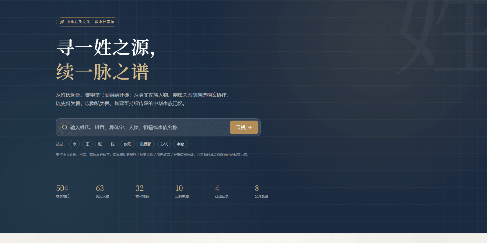
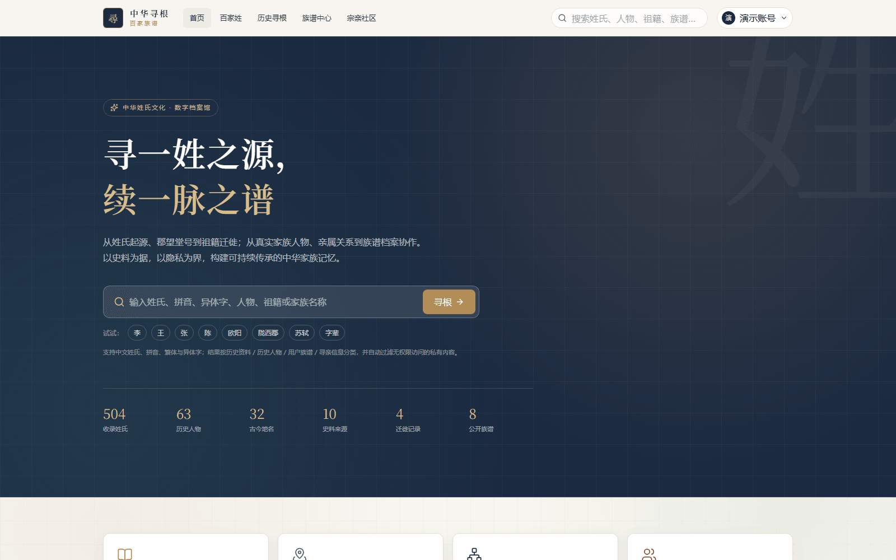
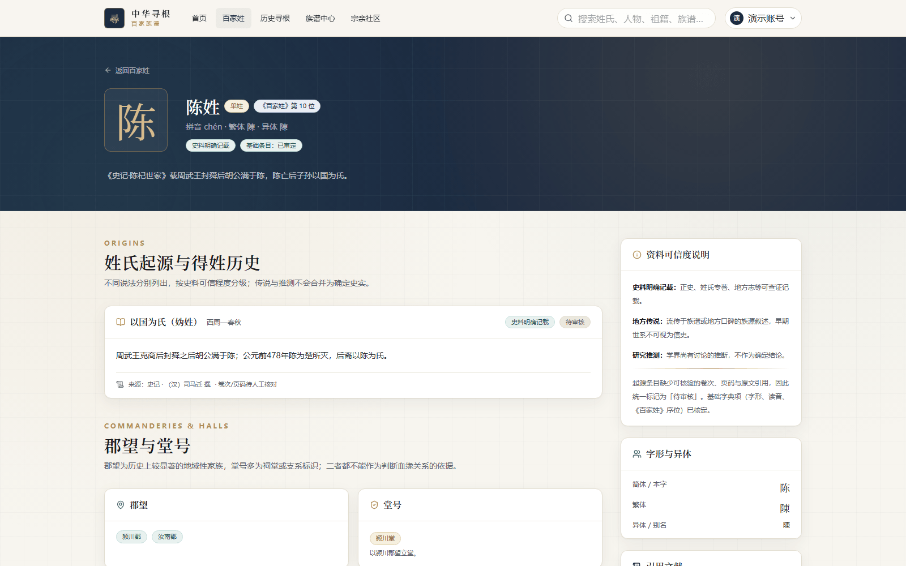
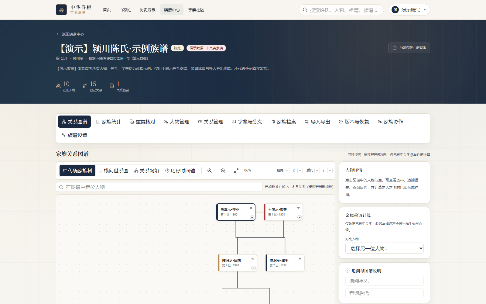
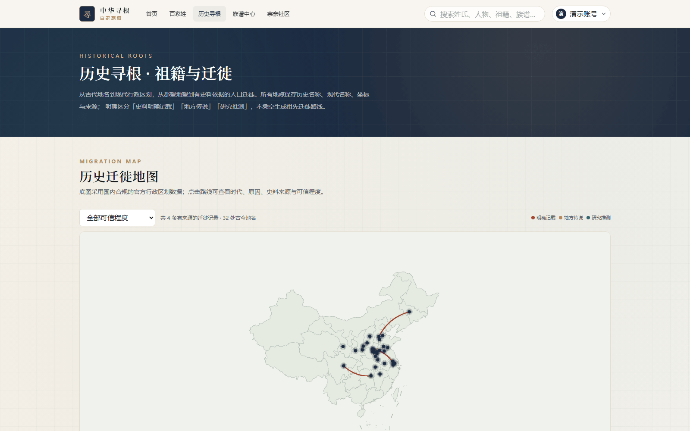

<div align="center">



# Chinese Genealogy & Heritage Platform

**中华寻根 · 百家族谱**

Trace the origin of a surname, continue the memory of a family — a Chinese surname-culture and genealogy platform built on documented sources and strict privacy boundaries.

[](https://github.com/yuchen0x1/Family-Genealogy-of-Hundreds-of-Clans/actions/workflows/ci.yml)
[](https://github.com/yuchen0x1/Family-Genealogy-of-Hundreds-of-Clans/releases)
[](LICENSE)
[](https://nextjs.org)
[](https://www.typescriptlang.org)

[中文说明](README.md) · [Features](#features) · [Quick Start](#quick-start) · [Privacy](#privacy--security) · [Docs](#documentation)

</div>

---

## Overview

A full-stack, real-implementation (no mock data) open-source platform combining two systems:

- **A digital archive of Chinese surname culture** — the complete 504-surname *Baijiaxing* table (444 single-character + 60 compound surnames), with cited historical sources, credibility grading (`DOCUMENTED / TRADITION / INFERRED / UNVERIFIED`) and review workflow.
- **A collaborative family-genealogy platform** — families, members, relationships, four graph views, kinship-title computation, generation poems & branches, document archives, GEDCOM/CSV/JSON import-export, version snapshots and restore, plus a self-hosted online updater.

**Three data boundaries that set it apart** (all enforced, not slogans):

1. Historical surname data ≠ user family relations — separate schemas, physically separated tables.
2. Historical figures ≠ family members — name matches never trigger auto-merge or relationship inference.
3. Same surname ≠ same clan — "kinship" links require explicit confirmation from both sides, and never create genealogical relationships.

## Features

| | |
| --- | --- |
|  |  |
| Home with unified search | Surname detail with graded sources |
|  |  |
| Relationship graph (4 views) | Family statistics dashboard |
|  |  |
| Historical migration map | Document archive center |

All screenshots come from the running application with seeded, clearly-marked demo data.

Highlights:

- **Surname knowledge base** — 504 surnames; 38 with source-cited entries (origins, variants, commanderies, hall names, historical figures); dictionary-type entries never fabricate origins.
- **Relationship graph** — classic family tree / horizontal lineage / force-directed network / timeline; incremental loading with a server cap of 200 nodes; ancestor & descendant tracing; kinship-title engine that only uses verified relationships (adoption and marriage are never treated as biological descent).
- **People management** — search across surname / given name / courtesy name / alias (pg_trgm backed); 8 relationship conflict checks incl. blood cycles; duplicate-person detection that only *suggests*, never auto-merges; soft-delete recycle bin.
- **Generations** — generation characters must be registered by the family; the system never infers generation from given names.
- **Archives** — triple upload validation (extension + MIME + magic bytes), SHA-256 checksums, versioning, files stored outside `public/` with per-request authorized download.
- **Import / export** — 7 real export formats (CSV / JSON / GEDCOM 5.5.1 / GEDCOM 7.0 / SVG / PNG / PDF); GEDCOM import with preview → explicit confirm → transactional write; imported relationships are marked `UNVERIFIED`.
- **Community** — PRIVATE/FAMILY/PUBLIC posts, two-level comments, moderation, messaging, notifications, mutual-confirm kinship applications that never create genealogical relations.
- **Admin console** — users & roles, moderation, source review, sanitized audit logs; admins can *never* read private families' member details, encrypted fields or archive contents (by design).
- **Self-hosted online updates** — check upstream releases, view changelog, one-click upgrade with forced backup, streaming archive validation and three drivers (SOURCE / DOCKER / SIMULATE); the target version is decided server-side only.

## Privacy & Security

| Mechanism | Details |
| --- | --- |
| Physical separation | Historical data and user genealogies live in separate tables; no auto-merge |
| Private by default | Families and members default to `PRIVATE`; publicity is an explicit act |
| Living-person protection | Non-public living members expose neither birth nor death years — including through the statistics API (aggregation cannot re-identify a birthday) |
| Field-level encryption | Sensitive member data encrypted with AES-256-GCM; list APIs never return ciphertext |
| Non-public storage | Uploads live outside `public/`, never directly reachable, downloads authorized per request |
| Admin minimization | The admin console processes metadata and review states only |
| Input defenses | Zod validation everywhere, parameterized queries, same-origin CSRF checks, multi-dimension rate limits, upload masquerade detection |
| Audited | 42 real-HTTP security checks pass; one accepted warning (`style-src 'unsafe-inline'`) is documented in [docs/SECURITY_AUDIT.md](docs/SECURITY_AUDIT.md) |

Not claimed: third-party penetration testing, WAF/CDN, production TLS certificates — these require infrastructure this project does not have.

## Tech Stack

| Layer | Choice (from `package.json`, verified by build) |
| --- | --- |
| Frontend | Next.js 16.4.5 (App Router / Turbopack), React 19.3.1, TypeScript 6.0.3, Tailwind CSS v4, SWR, ECharts |
| Backend | 68 Route Handlers, Zod, scrypt password hashing, AES-256-GCM field encryption |
| Database | PostgreSQL 17, Prisma 6.19 (48 models / 6 migrations), `pg_trgm` + Chinese 2-gram + pinyin search keys |
| Cache | Redis (auto-degrades to in-process cache when unavailable) |
| Storage | Local non-public directory (default) / S3-compatible object storage (opt-in) |
| Testing | Vitest (225 tests), 5 HTTP smoke suites (314 checks), Playwright E2E (11), security audit (42), perf baseline |
| Deployment | Dockerfile, docker-compose (app + nginx + postgres + redis + updater sidecar), Nginx TLS, systemd unit |

## Quick Start

Requirements: Node.js ≥ 22, pnpm 11 (Corepack).

```powershell
# Windows PowerShell
git clone https://github.com/yuchen0x1/Family-Genealogy-of-Hundreds-of-Clans.git
cd Family-Genealogy-of-Hundreds-of-Clans
corepack enable
Copy-Item .env.example .env    # replace SESSION_SECRET & ENCRYPTION_KEY for production

pnpm install
pnpm db:pg                     # bundled PostgreSQL 17 binary, data in ~/.xungen-pg

# in a second terminal
pnpm db:migrate                # 6 migrations
pnpm db:seed                   # roles, sources, surnames, places, migrations, demo family
pnpm dev                       # http://localhost:3000
```

```bash
# macOS / Linux
cp .env.example .env
pnpm install && pnpm db:pg
pnpm db:migrate && pnpm db:seed
pnpm dev
```

A public demo family (clearly marked, fictional) is seeded for exploring the UI. Demo account for local development only: `demo@xungen.local` / `Demo_Xungen_2026`. The seeded admin account must be changed or disabled immediately in production (see [docs/DEPLOYMENT.md](docs/DEPLOYMENT.md), section 9).

Docker:

```bash
docker compose up -d --build
```

## Documentation

| Doc | Content |
| --- | --- |
| [docs/USER_GUIDE.md](docs/USER_GUIDE.md) | User manual (Chinese) |
| [docs/API.md](docs/API.md) | Full API reference & permission model |
| [docs/DEPLOYMENT.md](docs/DEPLOYMENT.md) | Deployment, HTTPS, backup/restore, updater troubleshooting |
| [docs/TEST_REPORT.md](docs/TEST_REPORT.md) | Latest verified test round (592 automated assertions, 0 failures) |
| [docs/SECURITY_AUDIT.md](docs/SECURITY_AUDIT.md) | Security design & audit results |
| [docs/COMPLETION.md](docs/COMPLETION.md) | What is done, verified, and explicitly not done |
| [CHANGELOG.md](CHANGELOG.md) | Release notes |

## Testing

2026-11-10 release round, executed against a production build (`next build` + `next start`):

| Category | Result |
| --- | --- |
| Automated assertions | **592 total, 0 failures** (225 unit + 314 smoke + 42 security + 11 E2E) |
| Build | 91 routes (10 static + 81 dynamic), 20 pages |
| Backup/restore drill | 48 tables / 4,369 rows snapshot → restored row count independently verified |
| Performance baseline | 11 endpoints p95 ≤ 21 ms; 60 concurrent requests, 0 failures |

CI runs lint + typecheck + unit tests on every push/PR, plus a production build & smoke tests against a PostgreSQL 17 service container; `v*` tags automatically create a GitHub Release from the changelog.

## Roadmap

- **Done** (verified): surname knowledge base, migration map, genealogy core & graphs, kinship titles, archives, import/export, snapshots, community, admin console, online updater, backup/restore, Docker/Nginx configs
- **In progress**: batch source-text onboarding (38/504 surnames have documented entries), statistics dimensions, duplicate-detection tuning
- **Planned**: incremental blood-cycle detection, async bulk import (job queue), a11y audit, i18n
- **Needs external services** (interfaces reserved, no silent degradation): S3 storage, external OCR, PostGIS, Meilisearch/OpenSearch, WebSocket collaboration, production TLS, third-party pentest

## Contributing

Released under the [MIT License](LICENSE).

- 🐛 Issues: include reproduction steps; 🔐 security issues: use GitHub Security Advisories, not public issues
- 🔧 PRs: fork → branch → ensure `pnpm typecheck && pnpm lint && pnpm test` passes → describe motivation and verification
- 📜 Data discipline: historical claims require verifiable sources; nothing is generated without one

## Star History

<a href="https://star-history.com/#yuchen0x1/Family-Genealogy-of-Hundreds-of-Clans&Date">
 <picture>
   <source media="(prefers-color-scheme: dark)" srcset="https://api.star-history.com/svg?repos=yuchen0x1/Family-Genealogy-of-Hundreds-of-Clans&type=Date&theme=dark" />
   <source media="(prefers-color-scheme: light)" srcset="https://api.star-history.com/svg?repos=yuchen0x1/Family-Genealogy-of-Hundreds-of-Clans&type=Date" />
   
 </picture>
</a>

<div align="center">

Chinese surnames carry a thousand years of history;
a family line connects the memory of generations.

**Make every family memory traceable.**

</div>
